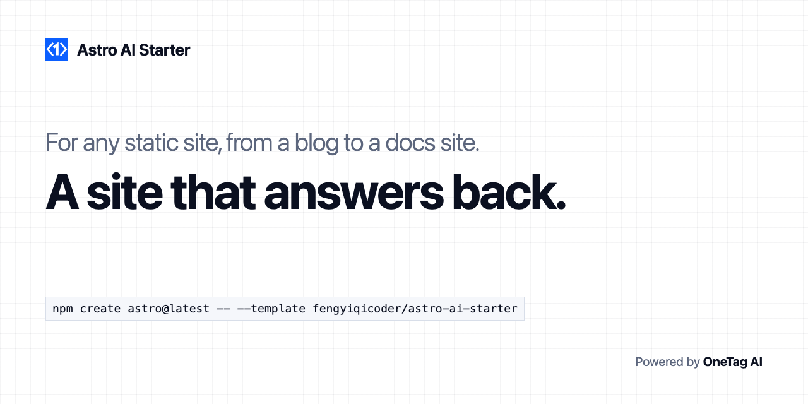

# Starter and Boilerplate for Astro 7, Tailwind CSS 4 and TypeScript, with AI built in.

<p align="center"><a href="https://fengyiqicoder.github.io/astro-ai-starter/"></a></p>

🚀 Astro starter with AI built in: the site answers questions, summarizes, translates and explains itself. Blog, docs and landing page included. One script tag, no backend ⚡️ Made with developer experience first: Astro 7 + Tailwind CSS 4 + TypeScript + MDX + Pagefind + llms.txt + AGENTS.md + GitHub Actions ✨

Clone it and you have a site that answers back: every page can summarize itself, translate itself and answer questions. Live demo: [fengyiqicoder.github.io/astro-ai-starter](https://fengyiqicoder.github.io/astro-ai-starter/).

```sh
npm create astro@latest -- --template fengyiqicoder/astro-ai-starter
```

## Sponsors

<table width="100%"><tr height="120px">
<td align="center" width="33%"><a href="https://onetagai.com/?ref=astro-ai-starter"><br>OneTag AI</a></td>
<td align="center" width="33%"><a href="mailto:fengyiqicoder@gmail.com">Add your logo here</a></td>
<td align="center" width="33%"></td>
</tr></table>

## Features

AI for your readers (each one degrades to a normal blog when no key is set):

- 💬 **Ask the blog**: a dialog (Ctrl+/) that searches the Pagefind index this build already makes, answers from the top posts and lists them
- ✂️ **TL;DR**: three sentences from the post, caveats kept
- 🌐 **Translate in place**: the post rewrites itself in the reader's language, headings and code untouched, one click back
- 🗣 **Ask the author**: a comment box that replies in the author's voice, from the current post only, with follow-ups
- 📚 **Read next**: three posts picked from the whole blog by what this post was about, with a reason each
- 🔎 **Explain selection**: select any passage and an Explain button appears
- 🧑‍💻 **Explain this code**: on every code block
- 📖 **Plain English**: rewrites the post with short sentences and common words, same facts
- 📣 **Share draft**: a post for X, a thread and a LinkedIn version, in the author's voice
- 🧪 **Test yourself**: three questions written from the post (opt-in per post)
- 🎯 **Reader fit** on the home page: say what you work on, get three posts
- 🔑 One public key, free 1,000,000 tokens, nothing stored, no API key in the page. Powered by [OneTag AI](https://onetagai.com/?ref=astro-ai-starter)

AI for you while writing:

- 🏷 `npm run ai:meta`: writes missing `description`, `tags` and `takeaways` into frontmatter, with a `--dry` preview
- 🖼 `npm run ai:alt`: writes alt text for images that have none
- 💾 Both cache by content hash in `.ai-cache/`, so the same text never costs tokens twice
- 🤖 `AGENTS.md` for Claude Code, Codex and Cursor, plus `llms.txt` and `llms-full.txt` on every build

Blog:

- 📝 Markdown and MDX posts with type-safe frontmatter (Zod)
- 🏷 Tags, drafts, reading time, previous/next
- 📡 RSS, sitemap, canonical URLs, Open Graph
- 🔍 Static search index with Pagefind
- 🌗 Light and dark mode, system default, one click to switch
- 💯 Lighthouse 100 / 100 / 100 / 100 on posts; the AI script loads only when a button is pressed

Developer experience first:

- ⚡ Astro 7, 🔥 TypeScript strict, 💎 Tailwind CSS 4
- 🎨 One design kit in plain CSS tokens: swap six colors to rebrand
- 👷 GitHub Actions: build and deploy to GitHub Pages on push; Netlify and Vercel work with zero config
- 🧩 Every AI feature is one Astro component you can copy into another site

## Philosophy

- Nothing is hidden: every AI call is a few lines you can read in `src/components/`
- No backend, no API key in the page, nothing stored
- Without a key it is a good blog; with a key it is a blog that answers back
- Dependencies updated every month
- Minimal code, production-ready

## Requirements

- Node.js 22.22+ and npm

## Getting started

```sh
npm create astro@latest -- --template fengyiqicoder/astro-ai-starter
cd my-blog
npm install
npm run dev
```

Open http://localhost:4321. Then get a free key and put it in `.env`:

```sh
curl -X POST https://onetagai.com/api/signup -H "Content-Type: application/json" -d '{"email":"you@example.com"}'
# the key arrives in that inbox
echo 'PUBLIC_ONETAG_KEY=ot_...' > .env
```

The key is public by design: it ends up in the HTML like an analytics ID and can only spend your account's allowance. On GitHub Pages, add it as the `ONETAG_KEY` Actions secret.

Need more than the free 1,000,000 tokens? [OneTag Pro](https://onetagai.com/?ref=astro-ai-starter#pricing) is $9.9/month for 100,000,000 tokens and lets you lock the key to your domain.

## Project structure

```
/
├── src/
│   ├── config.ts            # site name, author persona, languages, key
│   ├── content/blog/        # posts (.md / .mdx)
│   ├── components/          # one file per AI feature
│   ├── layouts/Base.astro   # header, theme toggle, footer
│   ├── pages/               # index, blog, tags, rss, llms.txt
│   └── styles/global.css    # design tokens and kit
├── scripts/                 # ai-meta.mjs, ai-alt.mjs
├── public/
└── .github/workflows/deploy.yml
```

## Writing posts

Add a file to `src/content/blog/`. Only `title`, `description` and `date` are required; every AI button is on by default and can be turned off per post:

```yaml
---
title: My post
description: One or two sentences.
date: 2026-11-09
tags: [astro]
ai: { tldr: true, askAuthor: true, translate: true, quiz: false, readNext: true }
---
```

## Customization

- **Voice**: edit `author.persona` in `src/config.ts`. Keep the "only from the post" rule.
- **Languages**: `ai.languages` in `src/config.ts`.
- **Colors**: the six tokens at the top of `src/styles/global.css` (and their dark-mode pair).
- **Remove a feature**: delete its component and its import in `src/pages/blog/[...slug].astro`.

## Deploy

Push to `main` and the included workflow deploys to GitHub Pages (enable Pages → Source: GitHub Actions once). For Netlify or Vercel, import the repo: build command `npm run build`, output `dist`.

## Contributing

Issues and pull requests are welcome. New AI features should follow the pattern in `src/components/ReadNext.astro`: one custom element, one `ask()` call, a clear message when no key is set.

## License

MIT. Powered by OneTag AI.
